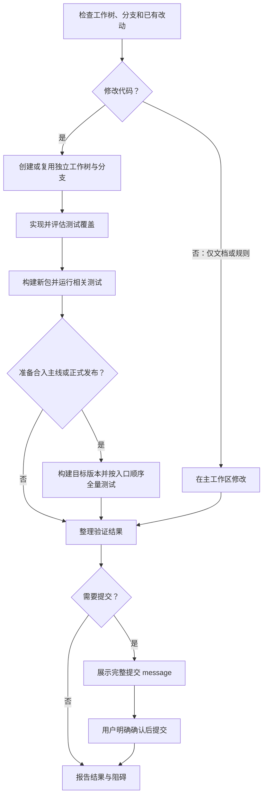

# 开发工作流

- 开始前检查工作树路径、当前分支和未提交改动，并保留已有改动。
- 修改代码必须使用与任务对应的独立 Git 工作树和独立分支，默认分支前缀为 `codex/`；可复用适合当前任务的工作树。仅修改文档或规则可直接在主工作区进行。
- 可按任务需要安排测试子 agent 准备测试、构建和执行验证；主 agent 负责实现、协调和汇总。共享工作树时明确各自修改范围，并在实现就绪后构建和验证，避免冲突。

# 测试与构建

- 新增功能或修复缺陷时，评估回归风险，按需补充测试；优先复用已有测试。专用测试组可从完整测试组中筛选相关用例，并补充当次修改的专项用例；记录所选和新增用例及覆盖范围。
- 开发期间，新增测试用例及测试入口调整保留在对应开发分支，不得提前单独合入主线。只有开发分支获准合入主线时，才将新增用例、功能代码及必要的测试入口调整一并合入，并确保新增用例纳入主线 `python tests/run_all.py` 的完整测试入口。开发或相关测试通过不代表已获准合入主线。
- 开发分支提交验证：先构建新包，再运行与改动相关的测试；公共底座或跨模块改动还须覆盖受影响的回归测试。不要求每次提交均运行全量测试。
- 合入主线或发布正式版本前：先构建待合入或待发布版本的新包，再按 `python tests/run_all.py` 定义的顺序运行全部测试组。
- 报告验证范围和实际结果；失败、跳过或未完成均不得视为通过，说明原因及阻碍。

# 米家测试

- `python -m unittest tests.test_mijia_service` 的 Windows DPAPI 测试需要当前用户的凭据环境。受限沙箱可能导致凭据加解密及依赖该功能的测试失败。
- 出现此类失败时，在有权限的沙箱外重跑同一测试，以复测结果判断，并同时报告两次结果；不得忽略真实失败。不要删除或修改用户米家凭据来排查。

# 提交审核

- 每次提交（含 amend）前，向用户展示完整提交 message，取得明确确认后才能提交；message 变更后须重新确认。
- 首行格式为 `NEW/FIX/ENH：简单内容`，任选一个前缀：NEW 新增、FIX 修复、ENH 优化；空一行后填写详细内容。

# 工作流程

