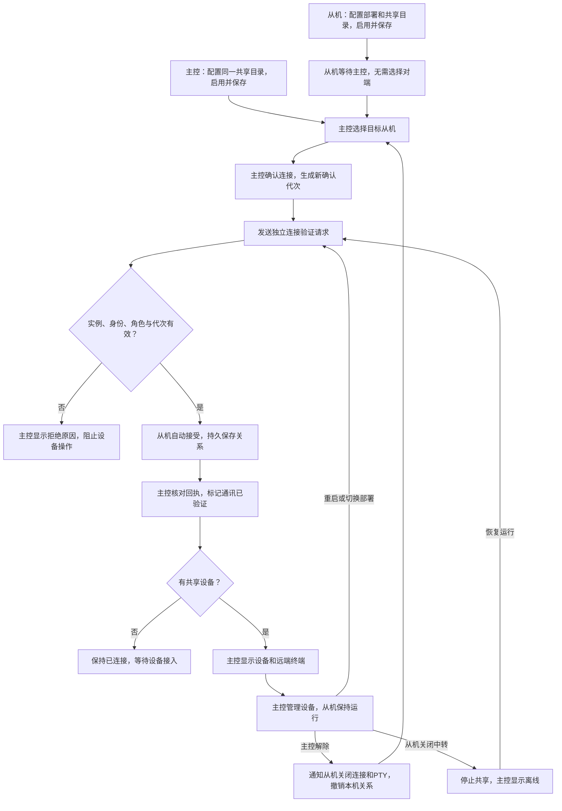

# 跨机中转：主控发起，从机等待

此流程替代此前「两端各点一次确认」的应用交互约定。

## 操作流程

1. 从机选择从机角色，设置部署标识与共享目录，启用并保存。本机名称固定，保存后显示「等待主控连接」，无需选择或确认对端。
2. 主控配置同一个实际共享目录并保存，从「连接对端」选择从机，核对机器名与部署，点击「确认连接」。
3. 主控自动发起连接验证，从机检查实例身份、在线状态、角色和确认代次后自动接受。回执实例键匹配后，两端显示「通讯已验证」。
4. 设备和终端自动出现在主控窗口。从机显示当前主控及连接状态，保持运行即可。设备共享范围、命令白名单与 shell 权限仍由从机设置。

主控确认前不展示远端可操作设备，不建立远端 PTY。连接验证独立于 ADB 与 PTY，没有设备也能接通。每个有效共享根（共享目录及可选 poolId）独立发现和配对，一根一主、可连接多个从机。切换根目录后需重新确认；不同根之间不互相发现、配对或路由。升级到根隔离版本后，已有旧配对需由主控重新确认一次；此后同根重启会自动验证。

## 流程图

## 前后端约定

- 从机不显示对端下拉框或确认按钮，仅显示等待、当前主控和共享状态；关闭中转即可停止共享。控制器同样拒绝从机主动配对或确认的 WebSocket 调用。
- 主控选择、确认、重新确认、解除连接。未保存的角色或目录变化仍会阻止连接操作。
- 只有 check-connection 能建立从机被动准入，普通设备请求不能建立连接。来源必须为在线且身份完整的主控，请求绑定 sourceNodeId、targetNodeId、connectionId。
- 主控每次人工确认产生新的 connectionId，从机保存已接受及退役代次。旧验证与设备请求不能恢复已解除连接，也不能回滚新的连接。
- 配对和信任记录只在本机保存；连接代次用于防误配、防串台和旧请求重放，不是密码认证。共享目录 ACL 仍是基础安全边界。
- 主控解除时先发送 close-connection，使在线从机撤销准入并关闭 PTY；无论回执结果如何，主控立即撤销本机关系。离线从机恢复后不会被主控继续操作，重新确认会生成新代次。
- 从机逐请求裁决设备所有权、命令白名单和 shell 权限。连接与目标目录、实例键、启动时间绑定，重启及换部署后重新验证。
- 逐对端 connectionState、connectionReason、reasonCode、nextAction、localConfirmed、verifiedAt 是界面的唯一依据。前端不能根据心跳或旧终端快照推断接通。
- 应用的 RelayNode 统一启用 passive_slave；底层库默认保留显式双端准入模式，兼容旧调用方和底层协议测试。

## 状态与下一步

| 状态 | 含义 | 下一步 |
|---|---|---|
| 从机等待主控 | 已配置但未接到有效连接验证 | 保持运行，主控选择并确认 |
| 主控待确认 | 已发现目标但尚未同意连接 | 核对机器名与部署后确认 |
| 正在验证 | 已确认，等待从机准入回执 | 等待自动验证，失败时按原因处理 |
| 通讯已验证 | 验证请求成功往返 | 主控管理设备，无设备则等待接入 |
| 对端离线 | 心跳中断，保留确认关系 | 启动对端或检查共享目录 |
| 连接已解除 | 原代次被撤销 | 主控重新确认连接 |
| 角色冲突或验证失败 | 准入或链路检查未通过 | 修复页面显示的原因后重试 |

## 2026-10-10 心跳序号观测（覆盖新版mtime在线判定）

应用每秒由自己的心跳线程写heartbeatSeq，携带nodeId、pid、startedAt作为启动代次。读取端观察同一代次序号严格增加，用本机monotonic记录最近推进时间；同值、缓存倒退、旧代次不刷新时间，首次发现一个旧文件不能证明在线。超过3秒未推进判离线。已发现实例的心跳由独立读任务持续采样，部署名册扫描不阻塞读端；界面、授权仲裁和操作前离线检查共享观测数据。没有序号的旧端继续使用原mtime兼容判断，新模式需双方升级。

uptimeSeconds由发布端的应用进程monotonic累计，独立于心跳次数，避免启动补写或发布失败影响运行时长；在连接详情展示。读取端观测时间只放内存，不写回共享目录。原心跳时间戳与兼容JSON保留供旧版本与诊断使用。

## 2026-10-12 从机同步显示远程终端

主控管理从机设备时，远端独立PTY的原始输出同时回传主控、广播到从机对应设备窗口。正常终端回显包含主控输入的指令及设备回复，中文分段与ANSI字节保持原样。镜像只用于显示，不再次写入从机本地PTY，因此指令只执行一次。密码等关闭回显的输入不额外广播。

从机本地输入仍作用于本机自动开启的独立shell，和主控shell的工作目录、环境变量不共享。关闭远程会话不关闭从机本地窗口。同步显示沿用设备key和terminal-data/base64通道，不修改准入流程，也不增加共享目录文件；窗口未创建时沿用前端输出缓冲。

## 2026-10-12 共享主会话与单方输入（覆盖上节独立shell镜像）

真实应用每台本地设备仍由 ADBWorker 创建一个 adb shell。SharedTerminalBackend 接入该现有会话，主控不再另开PTY。库调用方显式使用旧后端时保持兼容。文件传输和日志等独立ADB操作仍走原入口，本阶段不新增独立终端界面。

1. 主机接入后，主机可以输入，从机同一设备窗口只读；工作目录、环境变量及当前运行程序属于同一个会话。
2. 从机点击“接管”，本地获得新的输入代次，主机继续观察输出但不能输入或调整PTY尺寸。接管不发送Ctrl+C，不中断当前任务；输入会进入当前程序。
3. 从机点击“交还主机”，旧远端接入被撤销；主机使用新streamId重新接入。旧接入永远不能恢复写权限，迟到按键不会进入新接入；shell本身不重启。
4. 主机断开、解除连接或停止心跳超时，仅取消远程接入并释放控制，不关闭从机shell。主动接管状态保留到交还。设备掉线、从机退出或本地明确结束shell才关闭本地PTY。

控制状态经 terminal-control-status 推送到从机，包含owner、generation、shared和held；主控从会话meta获取控制状态。前端统一拦截只读状态下的终端输入，后端再校验当前控制方与本地输入/尺寸代次；只读端不能通过close-terminal终止shell。多行粘贴每段沿用同一代次，切换后剩余旧段被拒绝。

输出只由本地PTY读取一次：本地直接显示，远端使用独立有界队列写流，慢共享目录不堵住本地读取。接入时回放最多约128KiB最近输出并重置主机显示，避免重连接入重复累计历史；不会向设备发送换行或重放指令。这是终端字节回放，不提供任意全屏程序的完整屏幕快照。

默认采用共享主会话；按需独立终端是后续独立功能。本轮有可控PTY的真实双节点往返及真实Edge接管/交还检查，没有本地ADB设备时如实跳过真机PTY子检查。

## 主机主动接管共享终端

远程终端显示「从机控制」时，主机终端标题栏提供「接管」按钮。点击后经当前配对和连接代次发送请求，由从机确认终端接入与控制代次；迟到请求不能覆盖后来发生的接管。

从机允许主机接管后，旧输入流被撤销，主机重新接入同一个shell，再恢复输入。工作目录及已启动程序保留，旧主控按键和旧从机输入代次不能进入新接入。从机仍可随时使用原「接管」按钮取得控制权，或用「交还主机」释放控制。

新功能需主机和从机均更新。旧从机不识别接管请求时会明确拒绝，不在主机端伪造控制权成功。
